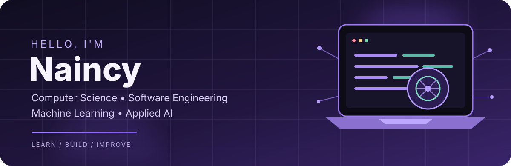

<!--
  NAINCY33 | GitHub Profile
  Keep this README project-led, concise, and evidence-based.
-->

  
   

  
  
  
  

---

## Hey, I'm Naincy 👋

**Computer Science undergraduate at B.M.S. College of Engineering, Bengaluru (2024–2028)**

I enjoy building software that connects solid engineering with practical AI. My work spans full-stack applications, machine learning workflows, deep learning, and retrieval-based AI systems. I also spend time solving DSA problems and understanding how scalable systems are designed.

- 💻 Interested in **Software Engineering, Backend Development and Applied AI/ML**
- 🧠 Studied supervised and unsupervised ML, neural networks, backpropagation, ANN, CNN and RNN/LSTM fundamentals
- 🏗️ Learning system design: scaling, load balancing, caching, CDNs, replication, rate limiting and distributed-system fundamentals
- 🔬 Building and improving projects that combine APIs, data, models and user-facing products
- 🤝 Open to internships, collaborative projects and meaningful open-source contributions

---

## Selected projects

<table>
  <tr>
    <td width="50%" valign="top">
      <h3>🇮🇳 HASTKATHA</h3>
      
An AI-enabled ecosystem for Indian traditional crafts. It brings together an artisan-focused marketplace, image-assisted listing generation, ML-based price intelligence and a RAG craft discovery assistant grounded in curated heritage data.

      
<b>Stack</b> Next.js · React · FastAPI · PostgreSQL · XGBoost · Sentence Transformers · ChromaDB

      <a href="https://github.com/Naincy33/HASTKATHA"><b>↗ Source code</b></a>
    </td>
    <td width="50%" valign="top">
      <h3>🛡️ FailSafe-AI</h3>
      
An AI-agent safety and testing project focused on analyzing agent behaviour, ingestion workflows, attack chains and classifier-driven risk assessment.

      
<b>Stack</b> Python · FastAPI · AI agents · Classification · Security testing

      <a href="https://github.com/Naincy33/FAIL_SAFE_AI"><b>↗ Source code</b></a>
    </td>
  </tr>
  <tr>
    <td width="50%" valign="top">
      <h3>📈 SubNexus</h3>
      
A subscription management and revenue intelligence platform with customer, billing and payment workflows, bank reconciliation, analytics and an ML-based churn prediction module.

      
<b>Stack</b> FastAPI · Python · React · TypeScript · PostgreSQL · Scikit-learn

      <a href="https://github.com/mimansa05/SubNexus-hackathon-odoo"><b>↗ Source code</b></a>
    </td>
    <td width="50%" valign="top">
      <h3>🧠 MeetMind AI</h3>
      
An AI meeting assistant that transcribes audio, creates summaries and action items, and lets users ask questions about meeting content using retrieval-augmented generation.

      
<b>Stack</b> Python · Whisper · LangChain · Hugging Face Embeddings · ChromaDB · Mistral AI · Streamlit

      <a href="https://github.com/Naincy33/MeetMind-AI"><b>↗ Source code</b></a>
    </td>
  </tr>
  <tr>
    <td width="50%" valign="top">
      <h3>⌨️ Next Word Prediction</h3>
      
An LSTM-based sequence model that predicts likely next words from an input text sequence, with a Streamlit interface and saved model/tokenizer for inference.

      
<b>Stack</b> Python · TensorFlow · Keras · LSTM · Streamlit

      <a href="https://github.com/Naincy33/NEXT_WORD_PREDICTION"><b>↗ Source code</b></a>
    </td>
    <td width="50%" valign="top">
      <h3>🌍 ForestLens</h3>
      
A project concept for AI-assisted deforestation monitoring using multitemporal satellite imagery, geospatial data and machine learning for environmental risk insights.

      
<b>Focus</b> Remote sensing · GeoTIFF · Raster data · Python · Machine Learning

      <a href="https://github.com/Naincy33"><b>↗ GitHub profile</b></a>
       Project repository/demo link can be added when published.
    </td>
  </tr>
</table>

---

## 🧰 Technologies & tools

**Languages**

**Frontend & backend**

**Data, ML & databases**

**Developer tools**

  
<b>More about my technical foundations</b>

  - **Data science:** NumPy, Pandas, Matplotlib, data cleaning, EDA, feature engineering and model evaluation.
  - **Machine learning:** supervised learning, unsupervised learning, regression, classification, decision trees, random forests and clustering.
  - **Deep learning:** perceptron, ANN, forward propagation, backpropagation, activation/loss functions, gradient descent, CNN and RNN/LSTM fundamentals.
  - **GenAI applications:** prompt engineering, embeddings, vector search, RAG pipelines and AI-agent concepts.
  - **System design:** vertical/horizontal scaling, load balancers, stateless services, caching, CDN, database replication, rate limiting and API design.
  - **Core CS & DSA:** arrays, strings, linked lists, stacks, queues, hashing, trees, graphs, heaps, tries, sorting, searching, recursion and dynamic programming.

---

## 🏅 Highlights

- 🥈 **Algothon — Runner-up**
- 🏅 **Code Forge Hackathon — Finalist**
- 🚀 **Adobe — Advanced to Round 2**
- 🎓 **IISc Bengaluru — Generative AI Workshop**
- 💻 Regular DSA practice on [LeetCode](https://leetcode.com/u/Naincy33/)

---

## 📊 GitHub at a glance

  
  

  
  

  

---

## 🐍 Contribution graph

  <picture>
    <source media="(prefers-color-scheme: dark)" srcset="https://raw.githubusercontent.com/Naincy33/Naincy33/output/github-contribution-grid-snake-dark.svg"/>
    <source media="(prefers-color-scheme: light)" srcset="https://raw.githubusercontent.com/Naincy33/Naincy33/output/github-contribution-grid-snake.svg"/>
    
  </picture>

---

## 🌱 Currently exploring

- System design and backend architecture
- Deep learning and sequence models
- RAG quality, retrieval strategies and evaluation
- AI agents, tool use and safe execution
- Building reliable, testable and deployable ML-powered applications

## 🤝 Let's connect

  <a href="https://github.com/Naincy33">GitHub</a> ·
  <a href="https://www.linkedin.com/in/naincy-5313551b3/">LinkedIn</a> ·
  <a href="https://leetcode.com/u/Naincy33/">LeetCode</a> ·
  <a href="mailto:iamnaincy33@gmail.com">Email</a>

   
  <i>Learn deeply. Build thoughtfully. Keep improving. ✨</i>
    
  

